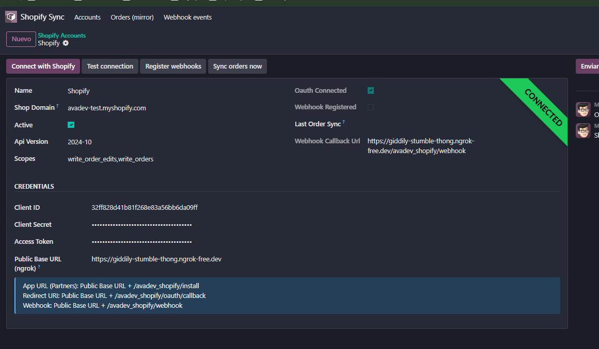

# Resumen ejecutivo — Sync de pedidos Shopify (v1)

**Para:** Santiago (Lead Tech, Natulim)  
**De:** Alfonso Villalpando  
**Vacante:** Odoo Developer y Key User  
**Fecha:** 2026-10-25  
**Código:** https://github.com/NemesisG38/natilum_test

---

## Qué se construyó

Integración Python que mantiene una **copia externa de pedidos Shopify** sincronizada desde la instalación en adelante, con:

- recepción de **webhooks** (`orders/create`, `orders/updated`);
- uso de la **Admin API** (lectura de pedidos y registro de webhooks);
- recorrido funcional demonstrable Shopify → base espejo.

La solución es el addon Odoo 19 `avadev_shopify_sync` (marca AVADEV). La “base externa” son modelos propios (`shopify.order.mirror` + líneas), **no** `sale.order`.

Alcance acotado a **~4 horas**: pedidos (alta + cambios posteriores), OAuth mínimo, HMAC, cola, pull de respaldo y vistas de operación.

**Fuera de v1**: productos, inventario, fulfillments, app embebida, multi-tienda genérica y puente a `sale.order`.

---

## Arquitectura (v1)

```text
Instalación app
  → GET /avadev_shopify/install
  → OAuth authorization code
  → GET /avadev_shopify/oauth/callback
  → access token en shopify.account

Pedido create/update
  → POST /avadev_shopify/webhook
  → verificar HMAC (client secret + body raw)
  → encolar shopify.webhook.event
  → 200 OK inmediato
  → cron 1 min → GET Admin API order → upsert espejo

Cron 10 min
  → GET orders?updated_at_min=…
  → upsert espejo (reconciliación / demo de API)
```

| Pieza | Rol |
|-------|-----|
| OAuth | App Partners standalone; scope `read_orders`; token offline en la cuenta |
| Webhooks + HMAC | Camino principal casi en tiempo real; rechazo 401 si la firma falla |
| Cola + cron 1 min | Cumple el timeout de Shopify (~5 s); patrón notify → fetch |
| Pull + cron 10 min | Respaldo si se pierde una entrega; botón “Sync now” |
| Upsert | Idempotente por `(account_id, shopify_order_id)`; líneas se recrean |

Stack: Odoo 19 Enterprise (lab), Python (`requests`), Postgres de Odoo, HTTPS vía túnel (p. ej. ngrok).

---

## Cómo probar (laboratorio)

1. Instalar `avadev_shopify_sync` en la BD de lab.
2. Crear `shopify.account` (shop, Client ID/Secret de Partners, Public Base URL HTTPS, API `2024-10`).
3. **Connect with Shopify** (OAuth) → **Register webhooks** → crear/actualizar un pedido en la tienda.
4. Verificar menú: eventos de webhook (`done`) y pedidos espejo con líneas.

Detalle de arranque Partners y túnel HTTPS: configurar App URL, Redirect URI y webhook con la base pública del laboratorio. No se versionan dominios temporales ni credenciales.

---

## Resultado E2E validado

Validado en lab (Odoo EE + túnel HTTPS) con la app Partners `natulim-prueba-odoo`: OAuth conectado, webhooks `orders/create`/`orders/updated` (HMAC OK, cola `done`), pedidos espejo `#1001`/`#1002`, pull/cron OK. Cumple el recorrido pedido: Python + webhooks + API + copia externa sincronizada.



---

## Limitaciones conscientes

- **Protected Customer Data (PCD):** pedidos/cliente pueden devolver 403 hasta completar el flujo de Partners / acceso a datos protegidos en la app. En lab se resolvió para la demo; en una app real hay que tratarlo como requisito de Partners.
- **REST Admin legacy:** lecturas y suscripción de webhooks por REST (`2024-10`). Shopify marca REST como legacy y pide GraphQL en apps públicas nuevas; deuda documentada.
- **Sin** `sale.order`**:** el espejo es auditable y desacoplado del ERP; no factura ni reserva stock.
- **Lab con túnel HTTPS:** URL pública temporal; no es despliegue productivo (el enunciado no lo exige).
- **Una cuenta por shop domain;** sin UI embebida en el admin de Shopify.

---

## Uso hoy y siguiente paso

**Hoy:** foundation usable como espejo/auditoría de pedidos (create + update), con OAuth y webhooks operativos en lab.

**No sustituye** el conector ERP completo (stock, fulfillments, returns).

**Recomendación:** adoptar esta v1 como base de integración de pedidos; siguiente versión opcional — migrar a GraphQL Admin, reconciliación por rango tras downtime prolongado, y/o puente espejo → `sale.order` si el destino operativo es Odoo ventas.

---

*Documentación de entrega para Natulim. Credenciales y secretos no se incluyen; van fuera del repositorio.*
